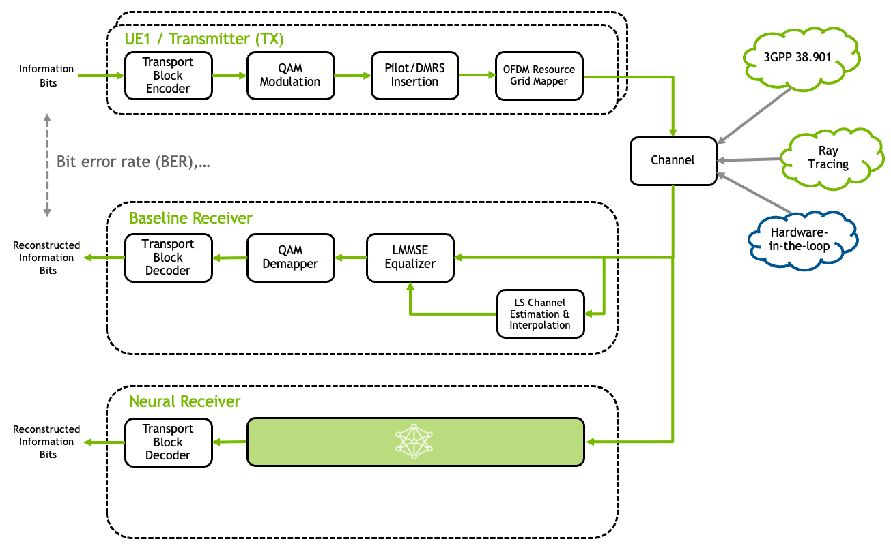
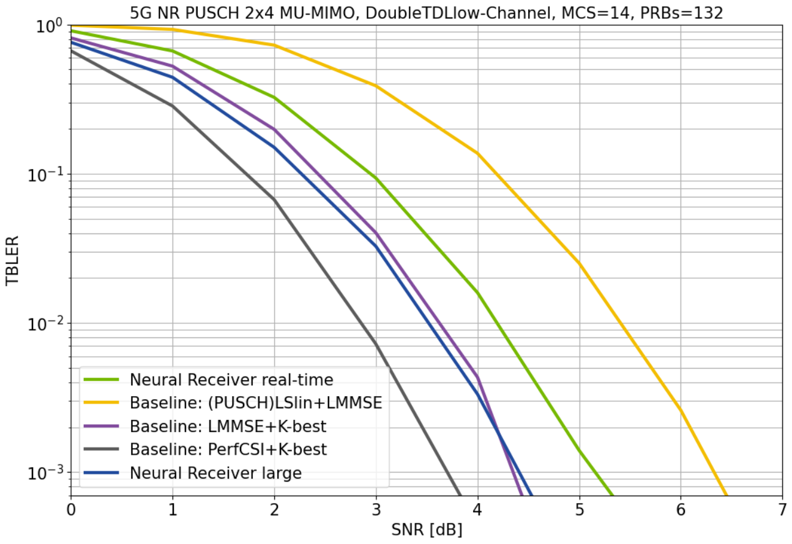
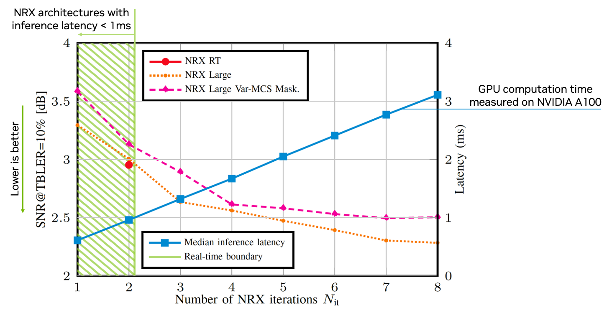

# Real-Time Inference of 5G NR Multi-user MIMO Neural Receivers

> :warning: **Warning**
>
> This project was originally released for Sionna 0.18.0 and was based on
> TensorFlow. The current codebase has been automatically migrated to PyTorch and Sionna 2.
> The complete original TensorFlow implementation is preserved in the
> `tensorflow` branch.

This repository provides PyTorch implementations for designing, training, and
evaluating 5G NR neural receivers with
[NVIDIA Sionna](https://nvlabs.github.io/sionna/). Trained receivers can be
exported to ONNX for real-time inference.

[<p align="center"></p>](notebooks/jumpstart_tutorial.ipynb)

The receiver operates on a complete PUSCH OFDM slot and jointly performs channel
estimation, equalization, and demapping. It supports:

- Multi-user MIMO PUSCH reception
- UMi, UMa, TDL, AWGN, and Sionna RT channel models
- Carrier frequency offsets
- Fixed and mixed assignments from PUSCH MCS table 1
- A varying number of active users
- Site-specific fine-tuning
- End-to-end constellation learning for pilotless communication
- Native and Aerial-compatible ONNX export

Start with the [jumpstart tutorial](notebooks/jumpstart_tutorial.ipynb).

[<p align="center"></p>](notebooks/jumpstart_tutorial.ipynb)

## Experiments

- `nrx_rt`: two CGNN iterations for low inference latency
- `nrx_large`: eight CGNN iterations for higher model capacity
- `e2e_rt`: four iterations with pilotless constellation learning
- `e2e_large`: eight iterations with pilotless constellation learning
- `nrx_*_qpsk` and `nrx_*_64qam`: fixed-MCS receivers
- `nrx_*_var_mcs`: variable-MCS receivers
- `nrx_site_specific*`: Sionna RT fine-tuning experiments
- `nrx_oai`: single-antenna, single-user receiver for OpenAirInterface
  deployments, with an Aerial-profile ONNX model in `onnx_models/nrx_oai.onnx`

The `nrx_rt` and `nrx_large` configurations train in two phases of one million
steps each. The E2E configurations train the constellation for 300,000 steps on
TDL-C300 and then fine-tune the receiver for 1.7 million steps on UMi. The
piloted one-CDM-group E2E baseline `e2e_baseline` fine-tunes `nrx_large` for
200,000 steps. `nrx_rt_var_mcs` trains for 100,000 and 2 million steps in its
first two phases, followed by 5.24 million low-SNR steps (with
`--compile-model --amp`); `nrx_large_var_mcs` trains for 100,000 and 1.9
million steps, followed by 363,000 low-SNR steps.

Pretrained checkpoints are stored in `weights/pretrained/`; the JSON file next
to each checkpoint records its receiver configuration and training run. Retrieve their Git LFS content after cloning:

```bash
git lfs install
git lfs pull
```

## Setup

Python 3.11 or newer and Sionna 2.1 or newer are required.

```bash
python -m venv .venv
source .venv/bin/activate
python -m pip install --upgrade pip
python -m pip install -e ".[dev]"
pytest
```

For a library-only installation:

```bash
pip install -e .
```

Install the PyTorch build appropriate for the target CUDA environment before
installing the remaining dependencies when the default wheel is unsuitable.

## Train

```bash
neural-rx train \
    --config config/nrx_rt.cfg \
    --output weights/runs/nrx_rt.safetensors
```

Training schedules, channels, active-user sampling, and Eb/N0 ranges are read
from the selected configuration. `--max-steps` and `--batch-size` provide
explicit development overrides. `--compile-model --amp` compiles the receiver
and runs it in bfloat16 autocast, which roughly halves the step time on Ampere
or newer GPUs.

Site-specific fine-tuning starts from a generalized checkpoint. The
ray-traced datasets in `data/` are generated by the site-specific notebook:

```bash
neural-rx train \
    --config config/nrx_site_specific.cfg \
    --init-checkpoint weights/pretrained/nrx_rt.safetensors \
    --output weights/runs/nrx_site_specific.safetensors
```

## Evaluate

```bash
neural-rx evaluate \
    --config config/nrx_rt.cfg \
    --checkpoint weights/pretrained/nrx_rt.safetensors \
    --output results/nrx_rt.json
```

Evaluation performs transport-block decoding and reports BER, BLER, CRC success
rate, and sample counts. For mixed-MCS configurations, `--mcs-indices` selects
one configured MCS entry for each user.

As in the TensorFlow release, `scripts/evaluate.py` sweeps all numbers of
active users and all configured MCSs for the neural receiver and the three
baselines. Its curves are stored in `results/`, which ships with pre-computed
results for all notebooks, and are reused by `plot_results` and `plot_gp`.
Stored curves are keyed by their settings only; pass `force=True` to
`run_bler` to re-simulate after changing code or checkpoints:

```bash
cd scripts
python evaluate.py -config_name nrx_rt.cfg
```

The channel is selected by `channel_type` and `channel_type_eval`: `UMi`,
`UMa`, `TDL-B100`, `TDL-C300`, `DoubleTDLlow`, `DoubleTDLmedium`,
`DoubleTDLhigh`, `AWGN`, or `Dataset`. A carrier frequency offset is enabled by
`cfo_offset_ppm` in `[training]` (drawn uniformly per user) and
`cfo_offset_ppm_eval` in `[evaluation]` (fixed).

## Export

```bash
neural-rx export \
    --config config/nrx_rt.cfg \
    --checkpoint weights/pretrained/nrx_rt.safetensors \
    --output onnx_models/nrx_rt.onnx
```

The ONNX interface uses real/imaginary feature packing, a dynamic batch
dimension, and returns LLRs. Add `--profile aerial` for the sparse LS-channel
input used by Aerial and TensorRT deployments. The grid size defaults to the
configured evaluation `n_size_bwp`; override it with `--n-size-bwp`.

[<p align="center"></p>](notebooks/real_time_nrx.ipynb)

The inference graph avoids full-resolution elementwise operations: the user
aggregation is one batched matrix product with zero weights for inactive
users, and intermediate states of inactive users are not masked because only
the masked readouts are observed. This is mathematically equivalent to the
previous graph, so existing checkpoints are unchanged, and it applies to every
export, including `neural-rx export`.

The TensorRT notebook additionally uses `TrainingAlignedAerialReceiver`
(`src/experiments/tensorrt_experiment.py`), which replaces the generic input
rearrangement of a fixed resource grid by a single precomputed gather through
`NeuralReceiver.forward_features`. With TensorRT 10.16 (FP16, 132 PRBs, two
users, batch size one) on an NVIDIA L40S, its benchmark of `nrx_rt` drops from
0.685 ms to 0.464 ms and that of `nrx_large` from 1.725 ms to 1.232 ms. For
the 24-PRB `nrx_oai` export used by the Sionna Research Kit, TensorRT 11.5
(FP16) on DGX Spark drops from 0.151 ms to 0.100 ms.

## Differences to the TensorFlow release

The port follows the TensorFlow implementation in the `tensorflow` branch. The
released PyTorch checkpoints and `onnx_models/nrx_oai.onnx` were trained with
the deviations below, so changing any of them requires retraining and
re-exporting:

- **Pilot positional encoding.** TensorFlow measures the distance to the
  nearest non-zero pilot and divides by the standard deviation whenever it is
  non-zero. The port measures the distance to the nearest resource element of
  the pilot pattern, including the zero-power ones, and divides by
  `max(std, 1)`. The frequency feature is therefore all zeros for `nrx_rt` and
  `nrx_large` (±1 in TensorFlow) and ±0.5 for `nrx_oai`.
- **Initialization and optimizer.** Convolutions use the PyTorch default
  initialization instead of Glorot-uniform weights with zero biases, and Adam
  uses `eps=1e-8` instead of `1e-7`.
- **Training schedules.** The second phase of `nrx_rt` and `nrx_large` runs
  for 1 million instead of 9 million steps; the second phase of the E2E
  configurations runs for 1.7 million steps on UMi instead of 9 million.
  `mcs_training_probs` is not supported; MCS indices are sampled uniformly.

## Tutorials

- [Jumpstart](notebooks/jumpstart_tutorial.ipynb)
- [Neural receiver architecture](notebooks/nrx_architecture.ipynb)
- [Pilotless end-to-end communications](notebooks/e2e_pilotless_communications.ipynb)
- [Variable-MCS receiver](notebooks/variable_mcs_nrx.ipynb)
- [Site-specific receivers](notebooks/site_specific_neural_receivers.ipynb)
- [ONNX and TensorRT deployment](notebooks/real_time_nrx.ipynb)
- [BLER and goodput visualization](notebooks/plot_results.ipynb)

## Repository structure

- `config`: experiment configurations
- `misc`: README figures
- `notebooks`: tutorials and complete experiments
- `scripts`: command-line wrappers
- `src/neural_rx`: model, PHY, training, evaluation, and deployment code
- `src/experiments`: BLER sweeps, plotting, and TensorRT helpers used by the notebooks
- `src/raytracing`: Sionna RT scene, CIR dataset generation, and site-specific sweep
- `tests`: unit and integration tests
- `weights/pretrained`: pretrained PyTorch checkpoints

Generated checkpoints, results, CIR datasets, and ONNX models are stored under
`weights/runs`, `results`, `data`, and `onnx_models`.

## References

1. S. Cammerer et al., [A Neural Receiver for 5G NR Multi-user
   MIMO](https://arxiv.org/pdf/2312.02601), IEEE GC Workshops, 2023.
2. R. Wiesmayr et al., [Design of a Standard-Compliant Real-Time Neural
   Receiver for 5G NR](https://arxiv.org/abs/2409.02912), 2024.
3. F. Aït Aoudia and J. Hoydis, [End-to-end Learning for OFDM: From Neural
   Receivers to Pilotless
   Communication](https://arxiv.org/pdf/2009.05261), IEEE TWC, 2021.

## License

Copyright © 2024-2026 NVIDIA Corporation. All rights reserved.

This work is available under the [NVIDIA License](LICENSE.txt).

## Citation

```bibtex
@software{neural_rx,
    title = {Real-time 5G NR Multi-user MIMO Receivers},
    author = {Sebastian Cammerer, Reinhard Wiesmayr, Fayçal Aït Aoudia, Jakob Hoydis, Tommi Koivisto, Jakub Zakrzewski, Ruqing Xu, Pawel Morkisz, Chris Dick, and Alexander Keller},
    note = {https://github.com/NVlabs/neural_rx},
    year = {2024}
}
```
